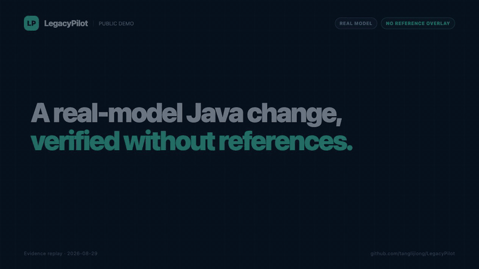

# LegacyPilot

> Enterprise Agent Harness for Java legacy systems.

LegacyPilot 是一个面向企业存量 Java 系统的开源智能研发 Agent。它接收需求或缺陷描述，在隔离的 Git worktree 中完成代码检索、影响分析、变更规划、受控修改、测试生成、Maven 验证与风险报告。

项目目标不是再做一个“把整个代码库塞进 Prompt”的演示，而是实现一个可控制、可观测、可评测、可验证的 **Single Agent + Strong Harness**。

## MVP 演示目标

输入需求：

> 转账接口新增每日累计限额。普通用户每天不得超过 5 万元，VIP 用户不得超过 20 万元，超过限额返回错误码 `TRANSFER_LIMIT_EXCEEDED`。

LegacyPilot 应能自动完成：

```text
导入 Java 项目
  -> 构建代码索引与依赖关系
  -> 生成影响分析和变更计划
  -> 人工批准高风险操作
  -> 在隔离 worktree 中修改代码
  -> 生成或补充单元测试
  -> 执行 compile / test / static analysis
  -> 失败后按预算重试
  -> 输出可审计的验证报告
```

当前确定性 Replay Agent 验收结果：

```text
Result: SUCCESS
Files modified: 4
Banking tests: PASS (standard / VIP / over-limit / UTC rollover / concurrency)
Compilation: PASS
Deterministic assertions: PASS
Risk: LOW
Token / Cost / Duration: recorded
```

## 公开演示



这段 41 秒演示回放真实 GPT-5.4 运行 `task-005` 的证据：模型未获得 reference solution，也未使用 reference overlay；它在隔离工作区修改生产代码，5 项公开断言全部通过，独立 Maven 测试通过。另见 [MP4](docs/assets/demo/legacy-pilot-task-005-real-model.mp4) 和[证据说明](docs/PUBLIC_DEMO.md)。

## 核心能力

- 自研 Agent Runtime：Plan → Act → Observe → Verify → Retry
- `CHANGE`、`ANALYZE`、`EXPLAIN` 三种任务模式；分析与讲解结果带源码证据且强制只读
- Java 代码上下文引擎：AST + BM25 + Vector + Dependency Graph
- 受控工具调用：文件系统、Git、Maven、代码搜索与补丁应用
- Docker / Git worktree 隔离执行与命令白名单
- Human-in-the-loop 审批和风险分级
- 版本化 Policy DSL 与短期最小权限 Capability Grant
- MCP Server：将 Java 项目、受权补丁与 Maven 能力开放给兼容客户端
- 多模型有限 Fallback、Provider 熔断与路由证据
- Revision-scoped Vector Store、Reranker 与显式降级
- Trace、Token、Cost、Duration 等运行观测
- 固定 Git revision 的安全源码片段读取、内容哈希校验与元数据审计
- 版本化 Checkpoint、Action Journal、Run Lease 和跨进程安全恢复
- 可重复运行的 Eval 数据集与成功率基准

## 技术方向

- Java 21、Spring Boot、Spring AI
- JavaParser、Lucene/BM25、可插拔向量存储
- Maven、JUnit、JaCoCo、SpotBugs/Checkstyle
- Docker、PostgreSQL/pgvector（按阶段启用）
- Micrometer、OpenTelemetry
- 自包含静态 Eval Dashboard（v0.3）

项目采用 Java 优先的模块化单体设计。v0.1 先完成可运行的端到端闭环，避免在验证价值前引入多 Agent、Kubernetes、IDE 插件或模型微调。

## 规划文档

- [文档导航](docs/README.md)
- [产品需求文档（PRD）](docs/PRD.md)
- [技术架构](docs/ARCHITECTURE.md)
- [仓库结构](docs/REPOSITORY_STRUCTURE.md)
- [路线图](docs/ROADMAP.md)
- [MVP Backlog：20 个 GitHub Issues](docs/MVP_BACKLOG.md)
- [架构决策记录](docs/DECISIONS.md)
- [已完成长期任务：Issue 02–04](docs/NEXT_TASK.md)
- [已完成长期任务：Issue 05、10、11](docs/NEXT_TASK_ISSUES_05_10_11.md)
- [已完成长期任务：Issue 06–09](docs/NEXT_TASK_ISSUES_06_09.md)
- [已完成长期任务：Issue 12–16](docs/NEXT_TASK_ISSUES_12_16.md)
- [Issue 17–20 工程验收与发布待办](docs/NEXT_TASK_ISSUES_17_20.md)
- [已完成长期任务：Issues 21–26 可恢复 Harness](docs/NEXT_TASK_ISSUES_21_26.md)
- [已完成长期任务：Issues 27–32 受治理工具链与模型韧性](docs/NEXT_TASK_ISSUES_27_32.md)
- [下一阶段长期任务：v0.2 收口与证据优先的精简 v0.3](docs/NEXT_LONG_RUNNING_TASK_V0_2_V0_3.md)
- [下一阶段长期任务：面试级 Web 产品化与端到端演示闭环](docs/NEXT_LONG_RUNNING_TASK_WEB_PRODUCTIZATION.md)
- [银行内网 PoC 交付计划与状态台账](docs/BANK_POC_DELIVERY_PLAN.md)
- [可恢复 Harness 运维指南](docs/RESILIENT_HARNESS.md)
- [受治理 Harness 指南](docs/GOVERNED_HARNESS.md)
- [30 分钟 Quickstart](docs/QUICKSTART.md)
- [ANALYZE 与 EXPLAIN 只读任务](docs/READ_ONLY_TASK_MODES.md)
- [MCP Server](docs/MCP_SERVER.md)
- [Eval Harness 与公开基线](docs/EVALS.md)
- [Eval Dataset v2 与 Fixture 治理](docs/EVAL_DATASET_V2.md)
- [公开演示证据](docs/PUBLIC_DEMO.md)

## 当前状态

`v0.2.0` 已正式发布：系统具备 Java 代码智能、受控工具、Agent Loop、审批验证、可授权写入的 STDIO MCP、可恢复长任务，以及 Policy/Capability、多模型路由、revision-scoped Vector/Reranker 和 Docker 依赖治理。发布证据见 [v0.2 清单](docs/RELEASE_CHECKLIST_V0.2.md)。

当前主线为 `0.3.0-SNAPSHOT`。20 题受治理 Eval、可恢复真实模型 Runner、失败分类、A/B 比较和离线 Dashboard 的工程实现已完成；统一执行 API、身份与职责分离、PostgreSQL 参考部署和运维材料已经具备。DeepSeek 已通过本机 loopback HTTP 在 M2 Max/Model Runner 上完成 Q4 实测：5 题 smoke 为 4/5，20 题完整结果为 9/20（45%）。因此工程与本地部署完成，但尚未达到既定 70% 模型质量发布门槛；这不依赖银行 OIDC、证书、测试身份、审批或 CUDA GPU 服务器，详见[交付台账](docs/BANK_POC_DELIVERY_PLAN.md)。

## 本地开发

要求 JDK 21 或更高版本。项目自带 Maven Wrapper：

```bash
./mvnw verify
```

提交代码前可自动应用格式：

```bash
./mvnw spotless:apply
```

完整构建会执行单元测试、架构边界测试、格式检查、Checkstyle、SpotBugs 和 JaCoCo 覆盖率检查。贡献约定见 [CONTRIBUTING.md](CONTRIBUTING.md)，安全问题请按 [SECURITY.md](SECURITY.md) 私下报告。

普通开发环境未启动 Docker 时，真实 Docker/PostgreSQL 集成测试会明确跳过；其余门禁仍需通过。银行 PoC 候选证据必须使用批准且按 digest 固定的镜像运行 `deploy/bank-poc/build-evidence.sh`，该脚本会在任何必需集成测试缺失、失败或跳过时失败关闭。

### 运行 REST 服务

```bash
./mvnw -pl apps/server -am spring-boot:run
```

生命周期 API 位于 `/api/v1`。Server 默认拒绝未认证访问并关闭 OpenAPI UI；仅在受控开发环境显式配置认证并设置 `LEGACY_PILOT_OPENAPI_ENABLED=true` 后开放 `/docs`。银行内网参考配置见 [`deploy/bank-poc`](deploy/bank-poc/README.md)。

### 运行 CLI

```bash
./mvnw -pl apps/cli -am package
java -jar apps/cli/target/legacy-pilot-cli-0.3.0-SNAPSHOT.jar --help
```

CLI 还支持带 `--mode CHANGE|ANALYZE|EXPLAIN` 的 `task-create`、以 JSON/Markdown 查看产物的 `task-result`、`agent-approve`、`agent-resume`、`agent-state-check`、`agent-recover`、`capability-issue`、`capability-revoke` 和五任务 `eval-run`。默认数据和受管 worktree 位于当前目录的 `.legacy-pilot/`；可分别通过 `LEGACY_PILOT_DATA_DIR`、`LEGACY_PILOT_WORK_ROOT` 与 `LEGACY_PILOT_AGENT_STATE_ROOT` 调整。

### 运行 Web 工作台原型

Web 工作台支持项目接入、三种任务模式、连续多轮对话、动态执行计划、只读边界、源码证据和变更审批，并已接入真实 REST API。同一项目中的追问会持久化为同一会话，刷新页面后仍可继续；模型在处理当前问题时会携带最近六轮已完成问答的摘要上下文。项目接入支持直接选择无 Git 的本地目录、填写后端可访问的普通目录或 Git 仓库路径，以及公共 Git URL；预检不运行编译，并展示内部固定快照、技术栈、可用能力与限制。项目不必使用 Git，不必是 Java，也不必能够编译。执行与审批恢复通过持久化幂等命令异步受理，关闭浏览器不会中断后台任务，服务重启后可重新领取未完成命令；运行进度通过可断线续传的 SSE 实时显示，并保留轮询降级。证据面板从固定快照安全读取源码，以 revision 和 SHA-256 检查漂移，并支持证据行定位、上下文展开、受控全文和路径复制。CHANGE 决策工作台由服务端统一生成计划、影响文件、文件/行级 diff、策略、双 digest、独立审批记录以及编译、测试、静态检查和覆盖率门禁状态；过期 digest 会失败关闭，拒绝理由可审计。恢复工作台会分类模型、工具、策略、验证和基础设施失败，以 run version 阻止过期页面操作，只展示安全的取消、重试、重新规划或人工复核路径，并保留每次 command attempt。用于本地面试演示时，先启动本地模型，再执行一条命令：

```bash
./deploy/demo/start.sh
```

打开 `http://127.0.0.1:5173`。脚本会检查环境、创建干净的 Banking Demo 快照、启动前后端并自动注册项目；工作台会取得仅限本机、本次进程有效的开发者与审批人身份。详细说明和第一条 `EXPLAIN` 演示提示见[本地演示指南](deploy/demo/README.md)。

发布前可运行 `./deploy/e2e/verify.sh`，通过同一入口执行 Java 全仓验证、Web 生产构建，以及连接真实 Spring/H2/Agent runtime 的 Playwright 浏览器门禁。失败截图、视频、trace、JSON/HTML 报告和服务端日志保存在 `apps/web/output/playwright/`；详见 [Issue 47 E2E 指南](deploy/e2e/README.md)。

面试候选发布使用 `./deploy/candidate/verify.sh`：它在上述门禁之上校验公开材料，并在固定 Banking Demo revision 上连续执行三次完整演示闭环。主演示、3 分钟精简版、架构图和答辩材料见[面试演示指南](docs/INTERVIEW_DEMO.md)，候选判定见 [v0.3.0-rc.1 说明](docs/RELEASE_CANDIDATE_V0.3.md)。候选仅表示产品演示验收通过；20 题模型质量仍为 9/20，未达到 70% 门槛。

普通前端开发仍可分别启动 REST 服务和 Vite：

```bash
cd apps/web
npm install
npm run dev
```

打开终端提示的网址即可体验。原型范围和后续 API 接入边界见 [Web 工作台第一阶段计划](docs/WEB_PROTOTYPE_PLAN.md)。

开发环境默认把 `/api` 代理到 `http://127.0.0.1:8080`。点击工作台右上角的连接设置，填入开发者 JWT；要演示写操作审批，还需填入属于另一身份的审批人 JWT。凭据只保存在当前浏览器标签页。

本地项目允许包含未提交改动，但只分析所选 revision 中已提交的内容；submodule 和 Git LFS 仍会被拒绝。远程注册仅接受不带凭证的公开 HTTP(S) Git URL。

## 明确不做

v0.1 不做多 Agent、COBOL 到 Java 自动转换、Kubernetes、IDE 插件、Jira/Jenkins 集成和模型微调。它们只有在核心闭环达到可量化的稳定性后才会进入后续版本。

## License

本项目使用 [Apache License 2.0](LICENSE)。
