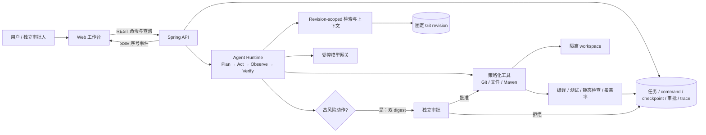

# LegacyPilot 面试演示与架构答辩

## 演示前固定条件

- Banking Demo revision：`ee79b3282e22aaf419a137666a57a2b1b3f4f875`；
- 主演示模型：本地 loopback DeepSeek-Coder-V2-Lite-Instruct Q4，reasoning effort `high`；
- Docker daemon 已启动；CHANGE 的 Maven 验证在离线容器 sandbox 中运行；
- 开发者与审批人是两个独立、仅本次进程有效的 Demo 身份；
- 启动命令：`./deploy/demo/start.sh`，页面地址为 `http://127.0.0.1:5173`；
- 开场先指出：产品闭环门禁已通过，但 20 题模型质量目前为 9/20，尚未达到 14/20（70%）发布门槛。

如果本机保留了旧版 `.legacy-pilot-demo`，确定性 revision 校验会拒绝启动。保留或移动旧目录后，以空的 `LEGACY_PILOT_DEMO_ROOT` 启动，不要覆盖历史任务。

## 8–10 分钟主演示

| 时间 | 操作 | 讲解重点与预期证据 |
| --- | --- | --- |
| 0:00–0:45 | 展示一条命令启动、顶部 revision 和两个 Demo 角色 | 真实服务、真实数据库、固定 Git 快照；不是静态原型。 |
| 0:45–2:15 | 创建 `EXPLAIN`：`请讲清楚转账业务的完整调用链，从 HTTP 入口到保存与异常路径，并为每项结论提供源码证据。` | 计划是调查而非改代码；结论、符号、行号、revision 和源码 hash 可回链；写入违规为 0。 |
| 2:15–3:30 | 创建 `ANALYZE`：`增加普通用户 50000、VIP 200000 的 UTC 单日累计限额，会影响哪些代码、并发规则和测试？` | 展示影响面、风险、未知项与推荐测试；强调不确定项不会伪装成事实。 |
| 3:30–5:40 | 基于确认需求创建 `CHANGE` | 展示计划、预计影响文件、逐行 diff、workspace/policy 检查和 action/plan 双 digest；此时文件尚未写入。 |
| 5:40–6:40 | 以独立审批人核对并批准 | 说明开发者不能自批；审批绑定精确 action 与 plan，内容改变后旧批准失效。 |
| 6:40–7:40 | 继续运行并查看验证结果 | 展示编译、测试、静态检查、覆盖率信息和最终报告；回答“改了什么、为什么改、谁批准、验证是否通过”。 |
| 7:40–8:45 | 演示断线或服务重启恢复 | 刷新页面或重启 Demo；任务、attempt、checkpoint 与事件序号来自持久化状态，SSE 不可用时降级轮询。 |
| 8:45–9:30 | 展示审计记录并收口 | correlation ID 串联页面、命令、run 与服务端诊断；再次区分产品验收和模型质量门槛。 |

不要等待模型时沉默：利用运行记录解释 Plan → Act → Observe → Verify、预算、checkpoint 和安全点取消。若模型输出偏离预期，直接将其作为“不可靠模型如何被 Harness 约束”的现场证据，并走重试或重新规划，不切换到预录结果冒充成功。

## 3 分钟精简版

1. 20 秒：说明遗留 Java 需求的难点不是生成文本，而是证据、写入治理和失败恢复。
2. 45 秒：打开一条已完成 `EXPLAIN`，点击结论回到固定 revision 的源码片段与 hash。
3. 70 秒：打开等待中的 `CHANGE`，展示 diff、策略、双 digest，以独立审批人批准并观察 Maven 验证。
4. 30 秒：刷新页面，展示任务、审批、attempt 和结果仍存在。
5. 15 秒：明确产品闭环通过，20 题质量仍是 9/20、未过 70% 门槛。

精简版可以复用同一场主演示提前创建的任务，但不得使用 route mock、截图或预录结果替代实时后端状态。

## 固定场景、预期输出与故障恢复

| 场景 | 注入点 | 可见表现 | 恢复方式 |
| --- | --- | --- | --- |
| SSE 断线 | 在浏览器网络工具中临时阻断 `/api/v1/runs/*/events` | “轮询降级”，任务仍在后端运行 | 解除阻断；客户端携带最后事件序号重连、去重补发。 |
| 页面刷新 | 运行中刷新页面 | 任务不会随标签页消失 | 从 REST、checkpoint 和持久化 command 重新水合。 |
| 服务重启 | 在非写入安全阶段停止并重启 Demo | 页面短暂显示未连接 | 同一 Demo root 重启；命令重新领取，已确认动作不重复。 |
| 模型故障 | 在新任务规划前暂停本地模型 | 运行分类为“模型失败”并保留诊断 | 恢复模型后点击“重试当前步骤”或“重新规划”，生成新 attempt。 |
| 审批拒绝 | 在 CHANGE 决策面板填写理由并拒绝 | 运行终止，拒绝身份、理由和 digest 可见 | 新需求必须创建后续 CHANGE；旧批准和拒绝均不复用。 |

自动候选演练使用确定性 OpenAI-compatible fixture，仅验证产品控制面，不计入模型质量；它在安全的注释差异上走完整审批和真实 Maven 验证。主演示使用上表记录的本地模型配置。

## 架构图

这张图的关键是两条闭环：读路径把结论绑定到固定源码证据；写路径把具体动作绑定到独立审批和验证。持久化不只是存聊天记录，而是保存可恢复状态机与审计事实。

## 三个高频答辩问题

### 为什么不是普通聊天机器人？

普通聊天只承诺一段回答。LegacyPilot 的输出有 task/run 状态机、固定 revision、源码证据、策略决策、action journal、独立审批和验证结果；断线后仍可恢复，写操作也不能靠提示词自行授权。

### 为什么不是 Codex 的复制品？

Codex 是通用编码产品；LegacyPilot 聚焦企业遗留 Java 的可部署 Harness：内网模型、Java 检索、Maven 门禁、职责分离、受管 workspace、持久化恢复和可审计 REST/SSE 契约。它可以接入不同模型或编码执行器，而治理语义由自身领域模型保证。

### 哪里体现 AI 工程能力？

能力不只在 Prompt。系统将模型输出约束为 schema，将源码证据做 revision/hash 校验，把写工具接入 policy、capability 和 digest 审批，以 checkpoint/action journal 处理超时和重放，再用真实编译测试闭环校验。这些设计假设模型会失败，并让失败可诊断、可恢复、不可越权。

## 演示收口话术

“这个候选版本证明的是：即使模型不完全可靠，LegacyPilot 仍能把它约束成一个可观察、可审批、可恢复、可验证的 Java Agent。产品演示和安全门禁已经通过；通用模型质量仍是 9/20，距离 14/20 发布门槛还有差距，下一步依据失败分类优化检索、Prompt 和模型，而不是用固定演示掩盖它。”
